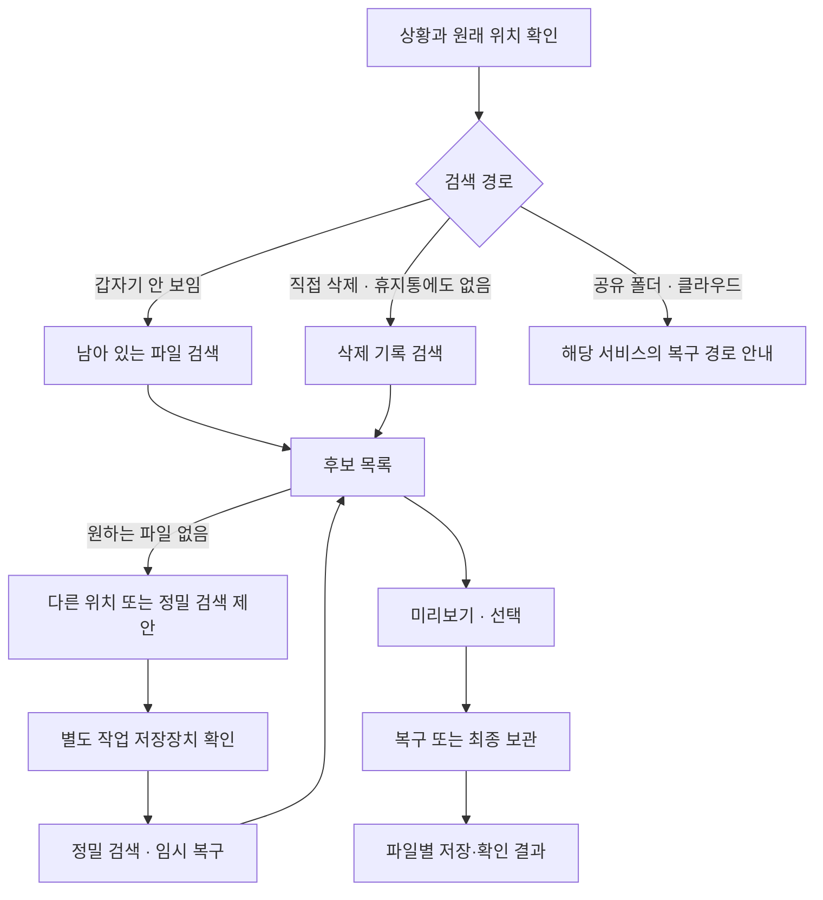
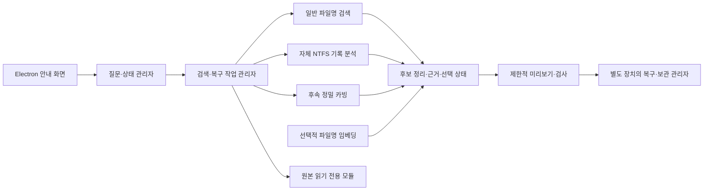

> **개발 이력 문서입니다.** 아래 수치·미지원 상태·실행 경로는 작성 당시 기록이며 최신 상태가 아닐 수 있습니다. 현재 상태는 [공개 현황](docs/STATUS.md)을 따릅니다. 기존 구현표 103/103과 현재 필수 인수 21/54는 서로 다른 기준입니다. 로컬 원자료 전체는 공개하지 않습니다.

# 공공 AX 로컬 시리즈 8 - 파일 복구

전체 기능 청사진 · 초안 1 · 2026-09-12

이 문서는 대화에서 합의한 개발 기준이다. 0.2.0은 실제 Electron GUI와 자체 읽기·검색·복구 엔진을 연결한 버전이다. NTFS/FAT/exFAT, 이미지 파티션 분석, 제한적 카빙·미리보기·손상 내용 추출, 선택형 파일명 임베딩을 구현했다. 기능별 완료 현황과 시험 근거는 BUILD_CHECKLIST.md, 개발 기록은 DEVELOPMENT_LOG.md, 정확한 지원 한계는 SUPPORT.md와 native 문서가 기준이다. 조건부 기능은 모든 변형을 지원한다는 뜻이 아니며 미지원 구조를 명시적으로 거절한다. 실제 사용자 장치 복구·UAC 경로·다양한 8GB PC 실증은 자동 합성 시험과 구별한다.

## 1. 제품 방향

목적은 휴지통에서도 사라진 파일을 찾고, 원본 보호를 고려해 별도 저장장치로 복구하는 것이다. 삭제하지 않았는데 보이지 않는 경우에는 이동·이름 변경·다른 위치의 복사본도 찾는다.

- Windows용 소형 Electron 프로그램. 기본 창 460×720, 테두리 없는 창과 옅은 파란색 제목 표시줄.
- 규칙형 챗봇이 한 번에 한 가지를 묻는다. 대부분 버튼으로 답하고 필요한 순간에만 입력창을 표시한다.
- 대화하는 생성형 AI는 사용하지 않는다. 파일명 의미 비교용 임베딩만 후속 선택 기능으로 둔다.
- 일반 사무용 8GB RAM·CPU 환경을 목표로 한다. 실행 속도·메모리 수치는 실제 측정 전에는 보장하지 않는다.
- 사용자용 검색 종류는 세 가지로 유지한다. 시작부터 고급 검사 옵션을 모두 보여주지 않는다.
- 원본에는 앱이 쓰지 않도록 설계한다. 복구본·작업 파일·로그·캐시·인덱스의 저장 정책도 포함한다.
- 후보 발견, 데이터 읽기, 파일 저장, 형식 검사, 원본 동일 확인을 서로 다른 사실로 취급한다.
- 데이터 소멸, 지원하지 않는 장치, 읽기 실패, 후보 없음은 다른 상태로 안내한다.

## 2. 개발 단계 표시

| 표시 | 의미 |
|---|---|
| 1차 | 첫 실동작 버전의 구현·검증 목표. 현재 구현 완료를 뜻하지 않음 |
| 2차 | 첫 복구 기능이 검증된 후 확장 |
| 조건부 | 장치·형식·모델·엔진 지원이 확인돼야 노출 |
| 제외 | 이번 제품에서 제공하지 않음 |

## 3. 기본 사용자 흐름

1. “파일이 어떻게 없어졌나요?” → 직접 삭제 / 찾아보니 없음 / 잘 모르겠음.
2. 상황에 맞춰 휴지통 확인 여부와 삭제 방법을 구별해 묻는다. 이미 받은 답은 재질문하지 않는다.
3. 원래 위치를 받는다. 컴퓨터 / USB·외장하드 / 폴더 선택 / 모름. 공유 폴더·클라우드 경로는 별도 안내한다.
4. 알고 있는 단서만 받는다. 파일명 전체·일부, 종류, 마지막으로 본 시점, 원래 폴더. 모름·건너뛰기를 허용한다.
5. 검색 범위와 다음 행동을 요약한다. 일반 파일 탐색은 바로 시작할 수 있고, 실제 데이터를 쓰는 복구 작업은 먼저 별도 장치의 작업 폴더를 지정한다.
6. 검색을 진행하면서 후보를 누적한다. 예상 남은 시간은 근거가 있을 때 범위로 갱신한다.
7. 후보를 몇 개씩 보고 미리보기·선택한다. 원하는 파일이 없으면 범위를 넓히거나 다른 검색으로 이어간다.
8. 선택한 파일을 복구하거나 임시 복구본을 최종 보관한다. 보관 위치·파일별 상태를 확인하고 작업을 마친다.

삭제 기록만 조회하는 작업과 파일 내용을 실제로 저장하는 작업은 구별한다. 미리보기에 임시 복구가 필요한 경우에도 별도 장치 지정이 먼저다. 정밀 검색은 원본 폴더 정보를 잃은 영역까지 다룰 수 있으므로 사용자의 이름·폴더 조건이 물리적인 읽기 범위와 항상 같지는 않다.

## 4. 안내 화면과 챗봇

| ID | 기능 | 단계 |
|---|---|---|
| UI-01 | 소형 창, 제목 표시줄 드래그, 최소화·최대화·닫기, 창 크기 변경 | 1차 |
| UI-02 | 한 번에 질문 하나와 소수의 선택 버튼 표시 | 1차 |
| UI-03 | 사용자가 누른 답을 내 말풍선으로 남기고 현재 단계 표시 | 1차 |
| UI-04 | 파일명 등 글로 답할 때만 입력창 표시, 제출하면 숨기기 | 1차 |
| UI-05 | 질문별 구체적인 입력 예시, 한글 입력 중 Enter 오작동 방지 | 1차 |
| UI-06 | 모름·건너뛰기·이전 답 수정·처음부터 시작 | 1차 |
| UI-07 | 검색 위치·조건을 짧게 요약하고 수정 가능하게 표시 | 1차 |
| UI-08 | 도움말, 단계별 용어 설명, 키보드 이동·확대 글자·고대비 대응 | 1차 |
| UI-09 | 검색 중에도 후보를 열어보고 안내 대화로 돌아오기 | 1차 |
| UI-10 | 시뮬레이션과 실검색을 명확히 구별하고 가상 파일을 실결과에 섞지 않기 | 1차 |

첫 버전에는 ‘무엇이든 물어보세요’ 입력창과 자유 대화 AI를 넣지 않는다. ‘내용만 기억나요’는 본문 검색을 지원하는 것처럼 오해할 수 있으므로 기본 질문에서 제외한다. 기억나는 설명을 파일명 의미 검색에 사용하는 후속 기능은 그 범위를 분명히 알린다.

## 5. 상황 분기와 사전 확인

| ID | 기능 | 단계 |
|---|---|---|
| IN-01 | 직접 삭제 / 갑자기 보이지 않음 / 원인 모름 분기 | 1차 |
| IN-02 | 휴지통 확인 여부와 휴지통 비우기 여부를 별도로 처리 | 1차 |
| IN-03 | 휴지통에 파일이 있으면 기존 복원 경로 안내 | 1차 |
| IN-04 | 일반 삭제·Shift+Delete 등 답을 검색 순서 참고로 사용, 절대적인 삭제 상태로 단정하지 않기 | 1차 |
| IN-05 | 드라이브·장치·폴더 선택, 연결된 장치와 사용 가능 상태 표시 | 1차 |
| IN-06 | 파일명 일부·확장자·종류·원래 위치·마지막으로 본 시점 입력 | 1차 |
| IN-07 | 공유 폴더·클라우드·온라인 전용 파일·미연결 장치 경로 구별 | 1차 |
| IN-08 | 물리 장치와 볼륨·드라이브 문자 매핑, 원본 장치 식별 | 1차 |
| IN-09 | 파일시스템과 읽기 권한·장치 잠금·지원 여부 확인 | 1차 |
| IN-10 | 원시 장치 접근 등 필요한 작업 직전에만 관리자 권한 요청 | 1차 |
| IN-11 | 원본이 시스템 장치일 때 앱 외의 Windows 쓰기까지 막는 것은 아니라고 안내 | 1차 |
| IN-12 | 저장되지 않은 새 문서는 삭제 파일과 다르므로 자동 저장·복구 기록 확인 경로 안내 | 2차 |

## 6. 사용자용 검색 세 가지

### A. 삭제 파일 찾기 — 자체 NTFS 엔진

목표는 정상 NTFS에서 삭제 기록이 남은 파일을 찾아 내용을 읽는 것이다. ‘최근 삭제’를 무조건 보장하지 않는다.

| ID | 기능 | 단계 |
|---|---|---|
| NT-01 | 테스트용 디스크 이미지와 지원 장치의 읽기 전용 데이터 공급자 | 1차 |
| NT-02 | NTFS 볼륨 기본 구조와 파일 관리 기록(MFT) 읽기·유효성 확인 | 1차 |
| NT-03 | 삭제 상태의 파일 기록 탐색, 남은 이름·크기·속성 수집 | 1차 |
| NT-04 | 부모 폴더 기록이 유효할 때 원래 경로 구성, 불확실하면 경로 미확인 표시 | 1차 |
| NT-05 | 파일명·확장자·종류·확인 가능한 날짜 필터 | 1차 |
| NT-06 | 기록 안에 들어 있는 작은 데이터와 외부 저장 영역의 기본 데이터 읽기 | 1차 |
| NT-07 | 유효한 저장 위치 목록을 해석하고 파일 순서대로 읽기 | 1차 |
| NT-08 | 기록 재사용·현재 할당 여부·잘못된 위치·범위 초과 등을 검사하고 불확실성 표시 | 1차 |
| NT-09 | 먼저 파일 후보 목록을 제공하고, 선택한 파일의 내용 읽기·복구 수행 | 1차 |
| NT-10 | 삭제 시각을 확인할 수 없는 경우 ‘모름’ 표시. 수정일·마지막 목격일을 삭제 시각으로 바꾸지 않기 | 1차 |
| NT-11 | 검증된 다중 구간 파일 복구 범위 확대 | 2차 |
| NT-12 | 특수 속성·복잡한 확장 기록·압축·희소 파일 등 처리 | 조건부 |
| NT-13 | FAT/exFAT 등 다른 파일시스템의 삭제 기록 분석 | 2차 |

현재 클러스터가 비어 있다는 사실만으로 원본 내용이 그대로 남았다고 판정하지 않는다. 첫 버전에서는 구현·시험으로 확인한 데이터 구조만 처리하며, 나머지는 지원하지 않는 속성으로 알린다. 초기 실증은 정상 NTFS의 단순한 파일과 별도 테스트 장치에서 시작한다.

### B. 깊게 찾아보기 — 기록 없는 영역 검색

| ID | 기능 | 단계 |
|---|---|---|
| DP-01 | 기본 검색에서 못 찾았을 때만 정밀 검색 제안 | 2차 |
| DP-02 | 지원되는 볼륨의 미할당 영역 검색, 필요할 때 더 넓은 범위 선택 | 2차 |
| DP-03 | 지원 파일 형식의 시작·구조 단서를 찾아 후보 추출 | 2차 |
| DP-04 | 별도 작업 폴더에 임시 복구하고 완료된 산출물만 후보로 공개 | 2차 |
| DP-05 | 원래 이름 없는 파일은 생성된 이름임을 표시하고 형식·크기·미리보기로 분류 | 2차 |
| DP-06 | 정상적으로 읽은 부분과 손상·읽기 실패 부분 구분 | 2차 |
| DP-07 | 불완전 파일·부분 텍스트·이미지 추출을 정상 전체 복구와 구분 | 조건부 |
| DP-08 | 조각 순서가 사라진 파일의 재조합, 손상 문서 형식별 수리 | 조건부 |
| DP-09 | 빠른 포맷·파티션 정보 손실 상황에서 이미지 기반 탐색 | 조건부 |

전체 장치의 모든 형식을 한 번에 복구한다고 약속하지 않는다. 읽기 오류가 반복되거나 물리 고장이 의심되면 같은 영역을 무한 재시도하지 않고 중단·전문 확인 경로를 제공한다.

### C. 복사본·비슷한 파일 찾기 — 남아 있는 자료 검색

| ID | 기능 | 단계 |
|---|---|---|
| CP-01 | 선택한 위치에서 현재 존재하는 파일명 검색 | 1차 |
| CP-02 | 일부 이름·공백·구분자·오탈자 등 일반 문자열 유사도 검색 | 1차 |
| CP-03 | 복사본·최종·수정본·날짜 접미사 등 이름 변형 후보 찾기 | 1차 |
| CP-04 | 파일 종류·크기·수정일·경로로 후보 좁히기 | 1차 |
| CP-05 | 서로 비교 가능한 파일의 해시로 내용 동일 후보 묶기 | 1차 |
| CP-06 | 이미 존재하는 파일은 위치 열기 또는 다른 장치로 복사 | 1차 |
| CP-07 | 지원 앱의 자동 저장본·백업·버전 기록 탐색 | 2차 |
| CP-08 | 작은 로컬 임베딩 모델로 파일명의 의미 유사도 보조 | 2차 |
| CP-09 | 모델이 없거나 꺼져 있어도 일반 검색을 완결, 작업 전에 필요성을 안내 | 2차 |
| CP-10 | 파일명·경로 인덱스의 선택적 재사용, 변경·삭제된 파일의 갱신 | 2차 |

임베딩은 남은 파일명 또는 복구된 원본 이름에만 적용한다. 카빙 과정에서 임의로 생성한 이름은 의미 검색 근거로 사용하지 않는다. 두 후보의 해시가 같다는 것은 두 후보끼리 같다는 뜻이며, 사라진 원본의 해시가 없는데 ‘원본과 동일’이라고 표현하지 않는다. 클라우드 계정 전체 연동과 네트워크 서버의 원시 복구는 범위 밖이다.

## 7. 후보 목록과 미리보기

| ID | 기능 | 단계 |
|---|---|---|
| CA-01 | 우선 후보 3~5개와 더 보기, 전체 개수·현재 확인 범위 표시 | 1차 |
| CA-02 | 파일명·경로·크기·확인 가능한 날짜·발견 이유 표시 | 1차 |
| CA-03 | 삭제 기록 / 정밀 추출 / 현재 남은 파일 등 발견 출처 표시 | 1차 |
| CA-04 | 이름 비슷함 / 파일명 의미 비슷함 / 비교한 파일끼리 동일 등 판단 근거 구별 | 1차·2차 |
| CA-05 | 새 후보는 누적하되 보고 있는 카드와 선택 상태가 갑자기 이동하지 않도록 처리 | 1차 |
| CA-06 | 여러 파일 선택·선택 해제·선택 항목 확인, 필터 변경 후 선택 유지 | 1차 |
| CA-07 | 이름·종류·크기·날짜 필터와 사용자 정렬 | 1차 |
| CA-08 | 여기에 없음 → 다른 후보·검색 범위 확대·다른 검색 종류 제안 | 1차 |
| CA-09 | 이미지·텍스트·PDF의 제한적 미리보기 | 1차 |
| CA-10 | Office·HWP·HWPX 미리보기와 구조 검사 | 2차·조건부 |
| CA-11 | 작성 중·암호 설정·미지원·손상으로 미리보기 불가한 이유 구별 | 1차 |
| CA-12 | 미리보기에서 매크로·외부 연결·실행 파일을 자동 실행하지 않기 | 1차 |

‘이 파일이에요’는 선택을 뜻한다. 실제 저장이 발생하는 버튼에는 저장 위치와 동작을 표시한다. 후보가 하나여도 ‘찾으신 파일인지 확인해주세요’로 안내한다. 숫자로 만든 복구 성공 확률은 근거 없이 표시하지 않는다.

## 8. 복구·저장·결과

| ID | 기능 | 단계 |
|---|---|---|
| OUT-01 | 쓰기 작업 전에 원본과 다른 물리 장치의 작업 폴더 지정 | 1차 |
| OUT-02 | 드라이브 문자가 달라도 같은 물리 장치면 제한, 관계를 확인 못하면 안내 | 1차 |
| OUT-03 | 출력 권한·여유 공간·파일시스템의 파일 크기 한계 확인 | 1차 |
| OUT-04 | 선택 파일만 복구하거나 임시 복구된 파일을 최종 보관 | 1차 |
| OUT-05 | 기록이 확인되는 범위에서 폴더 구조 보존, 알 수 없는 경로는 별도 폴더 사용 | 1차 |
| OUT-06 | 동일 이름 충돌 시 기본적으로 덮어쓰지 않고 번호·별도 폴더 사용 | 1차 |
| OUT-07 | 출력 경로의 잘못된 문자·상위 경로 이동·예상 폴더 밖 저장 방지 | 1차 |
| OUT-08 | 진행 중 임시 파일과 완료 파일 분리, 중단 파일을 정상 저장본으로 표시하지 않기 | 1차 |
| OUT-09 | 파일별 저장 완료·부분 저장·쓰기 실패·확인 불가 표시 | 1차 |
| OUT-10 | 실패한 항목 재시도, 저장 위치 바꾸기, 성공한 파일 유지 | 1차 |
| OUT-11 | 결과 폴더 열기·결과 목록 저장·다른 후보로 돌아가기 | 1차 |
| OUT-12 | 임시 파일과 최종 보관본 구별, 사용자가 정리할 대상·용량을 확인한 뒤 정리 | 1차 |
| OUT-13 | 정답이 있는 시험에서는 원본·복구본 해시 비교, 실사용에서는 확인된 검사 범위만 표시 | 1차 |

## 9. 진행 관리와 알림

| ID | 기능 | 단계 |
|---|---|---|
| JOB-01 | 검색 중에도 창·버튼이 응답하도록 UI와 실제 작업 분리 | 1차 |
| JOB-02 | 현재 단계·읽은 범위·발견 수·선택 수 표시 | 1차 |
| JOB-03 | 속도를 관찰해 예상 남은 시간 범위를 갱신, 불확실하면 계산 중 또는 예측 어려움 표시 | 1차 |
| JOB-04 | 유력 후보 발견 / 주기적 진행 상황 / 완료 시 알림 선택 | 1차 |
| JOB-05 | 후보를 좁힐 단서가 없으면 ‘유력 후보’ 알림을 약속하지 않기 | 1차 |
| JOB-06 | 주기 알림은 매번 답을 요구하지 않고, 후보는 언제든 확인 가능 | 1차 |
| JOB-07 | 검색 취소와 중지 처리 중 상태, 완료된 후보·출력 보존 | 1차 |
| JOB-08 | 일시정지·이어하기는 엔진에 안전한 중단 지점이 구현된 범위에서 제공 | 조건부 |
| JOB-09 | 앱 재실행 후 이어하기, 작업 기록 복원과 원본 장치 재확인 | 2차·조건부 |
| JOB-10 | 최소화 상태에서도 계속 검색, 닫기와 작업 종료를 명확히 안내 | 1차 |
| JOB-11 | 이름·날짜 변경은 후보 재평가, 원본 변경은 별도 작업으로 처리 | 1차 |
| JOB-12 | 절전·장치 분리·프로그램 오류 후 중단 상태 처리 | 1차 |

시간 알림은 사용자가 시작한 현재 작업 안에서 동작한다. 별도 상시 서비스·예약 작업·트레이 상주는 기본 기능으로 만들지 않는다. 시스템 알림의 파일명 노출 여부와 알림 빈도는 조절 가능하게 한다.

## 10. 예외·성능·개인정보

| ID | 기능 | 단계 |
|---|---|---|
| SYS-01 | 후보 없음 / 범위 일부 미검사 / 권한 없음 / 잠긴 장치 / 사용자 중단 구별 | 1차 |
| SYS-02 | 장치 연결 끊김·읽기 실패·출력 공간 부족·쓰기 실패별 안내와 다음 행동 | 1차 |
| SYS-03 | 재연결된 장치의 식별, 읽기 오류 재시도 횟수 제한 | 1차 |
| SYS-04 | 한 번에 정밀 작업 하나, 자료를 나눠 읽기, 후보 페이지 나누기 | 1차 |
| SYS-05 | 큰 파일·복잡한 미리보기의 처리 크기·시간 제한 | 1차 |
| SYS-06 | 임베딩은 요청할 때만 실행, 원본 장치에 모델 설치·다운로드하지 않기 | 2차 |
| SYS-07 | 기본 오프라인 처리, 파일 내용·이름의 자동 업로드 없음 | 1차 |
| SYS-08 | 최소한의 진단 기록과 사용자용 결과 목록 구별, 기록 저장 위치·지우기 제공 | 1차 |
| SYS-09 | 실행 압축 해제·사용자 데이터·세션 캐시·로그의 외부 작업 위치 정책 | 1차 |
| SYS-10 | 손상된 파일과 장치 메타데이터를 신뢰하지 않고 길이·위치·작업 범위 검사 | 1차 |
| SYS-11 | 일반 GUI와 권한이 필요한 장치 읽기 모듈 분리, 제한된 작업 명령만 전달 | 1차 |
| SYS-12 | 버전·지원 기능·오픈소스 고지·모델 및 종속 라이선스 목록 제공 | 1차 |

GUI가 닫혔다고 자동 복구 성공으로 기록하지 않는다. SSD 삭제는 TRIM·실제 남은 데이터에 따라 결과가 다르며, 소프트웨어가 ‘덮어쓰기 없음’을 모든 경우 확정할 수 있다고 약속하지 않는다.

## 11. 파일 형식별 지원을 나누는 방법

| 단계 | 판단할 내용 |
|---|---|
| 이름·기록 발견 | 파일시스템에 남은 이름·크기·위치 정보를 읽을 수 있는가 |
| 바이트 복구 | 지원하는 저장 구조에서 해당 파일 데이터를 읽어 저장할 수 있는가 |
| 미리보기 | 저장한 데이터의 형식을 안전하게 해석해 일부를 보여줄 수 있는가 |
| 구조 검사 | 파일의 구조·구성 항목을 지원 범위 내에서 확인할 수 있는가 |
| 원본 동일 | 비교할 원본 또는 신뢰할 수 있는 원본 해시가 있는가 |

HWP·HWPX·DOCX·XLSX·PPTX·PDF·TXT·JPG·PNG·ZIP 등 실제 사무 자료를 지원표에 넣되, 다섯 단계를 모두 지원한다고 일괄 표시하지 않는다. 메타데이터 기반 바이트 복구에 성공해도 미리보기는 미지원일 수 있다. 카빙은 별도로 구현된 형식만 지원한다.

## 12. 내부 구조

원시 디스크 읽기·파일시스템 분석·실제 복구는 화면의 JavaScript와 분리한 작업 모듈에서 수행한다. 복구 엔진은 Node.js 기본 모듈, Windows 장치 읽기는 C# 읽기 전용 도우미, GUI 연결은 제한된 Electron IPC 및 Worker를 사용한다. 선택형 파일명 임베딩 구성은 별도 AI 팩으로 고정한다. 필요 이상으로 독자 구현 범위를 늘리지 않되, 외부 코드를 사용하면 해당 라이선스를 확인한다.

## 13. 단계별 완료 기준

| 단계 | 산출물과 완료 기준 |
|---|---|
| A. 기반 | 원본 읽기와 별도 작업 저장 위치, 테스트용 디스크 이미지, 원본 쓰기를 시도하지 않는 구조 |
| B. 최초 자체 복구 | 지원하는 정상 NTFS 삭제 기록에서 후보를 찾고 선택 파일을 복구. 정답 원본과 바이트·해시 비교 통과 |
| C. 사용자용 첫 버전 | 버튼형 대화, 조건부 입력창, 후보·미리보기, 안전한 저장, 중단·실패·권한 분기, 일반 파일명 검색 |
| D. 정밀 검색 | 제한한 파일 형식부터 카빙 구현, 부분·오탐·조각난 파일의 한계 기록, 임시 출력 관리 |
| E. 검색 보조 확장 | 파일명 의미 임베딩과 필요한 자동 저장본 경로, 모델이 없어도 기본 검색 유지 |
| F. 확대 | 다른 파일시스템, 추가 형식, 검증된 재개, 고급 문서·조각 복구 |

8GB 사무용 PC에서 초기 실행, 기본 검색, 정밀 검색, 미리보기, 선택적 임베딩 각각의 최대 메모리·CPU·디스크 부하·UI 응답성을 측정한다. 시간 추정은 검색과 실제 파일 저장을 구별한다. 정상 사례뿐 아니라 기록 재사용, 덮어쓰기, 잘못된 구조, 장치 분리, 출력 공간 부족, 파일명 충돌, 긴 경로, 한글 이름, 미지원 속성을 시험한다. 검증용 자료는 별도의 재현용 디스크 이미지·장치를 사용한다.

## 14. 명시적인 제외와 한계

- 생성형 AI 채팅, 원본을 추측해서 새 문서를 만드는 ‘AI 복구’.
- 파일을 잃은 뒤 실제 정보와 모든 사본이 소멸한 경우의 원본 재생성.
- 암호키나 유효한 잠금 해제 수단이 없는 강한 암호화의 우회.
- SSD TRIM을 무조건 무력화하는 기능, 모든 삭제 상태의 복구 보장.
- 칩 분리·헤드 교체·고장 컨트롤러 수리 등 물리 복구.
- 첫 버전의 RAID·NAS 원시 복구, 클라우드 계정 전체 연동.
- 삭제된 프로그램의 레지스트리·서비스·라이선스까지 포함한 완전 재설치 복원.
- 첫 버전의 손상 파티션 수리·부팅 복구·원본에 기록하는 복구 명령.
- 상시 디스크 감시·자동 백업·예약 스캔·자동 업데이트 상주 서비스.

‘우리 앱에서 지원하지 않음’, ‘현재 검색에서 찾지 못함’, ‘원본 정보 자체가 없음’을 구별한다. 물리 고장은 전문적인 수리로 읽을 수 있는 경우도 있으므로 곧바로 누구도 복구할 수 없다고 단정하지 않는다.

## 15. 설계 근거

- NTFS의 기록 기반 탐색, 삭제 후 덮어쓰기와 원본·출력 분리: [Microsoft Windows File Recovery](https://support.microsoft.com/en-us/windows/experience/backup-recovery/windows-file-recovery).
- 파일명 상실, 임시 출력·진행 중 결과, 일부 조각 복구와 자원 한계: [PhotoRec 공식 문서](https://www.cgsecurity.org/testdisk_doc/photorec.html).
- 임베딩을 이용한 의미 비교 원리: [Sentence Transformers](https://www.sbert.net/examples/sentence_transformer/applications/semantic-search/README.html).
- 제품의 실행·저장·실패 처리에 대한 세부 검토: [계획 검토](<C:/Users/USER/Documents/가자 로컬의 세계로/RecoveryChat.GUI/PLAN_REVIEW.md>).

이 청사진의 ‘자체 개발 가능’은 모든 장치·파일 상태에서 성공한다는 의미가 아니다. 제공 기능은 구현하고 실제로 확인한 지원 범위에 맞춰 공개한다.
