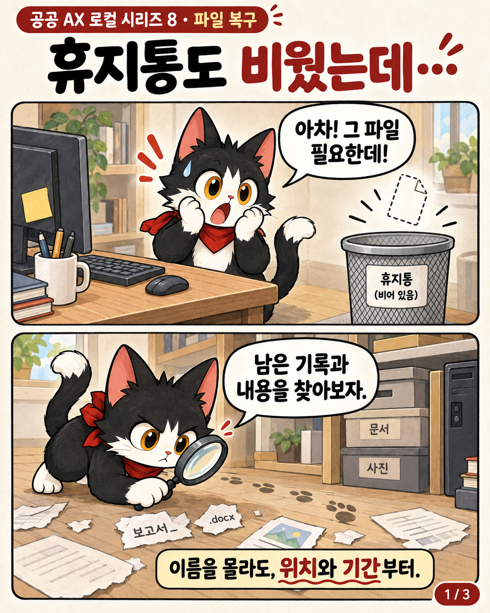
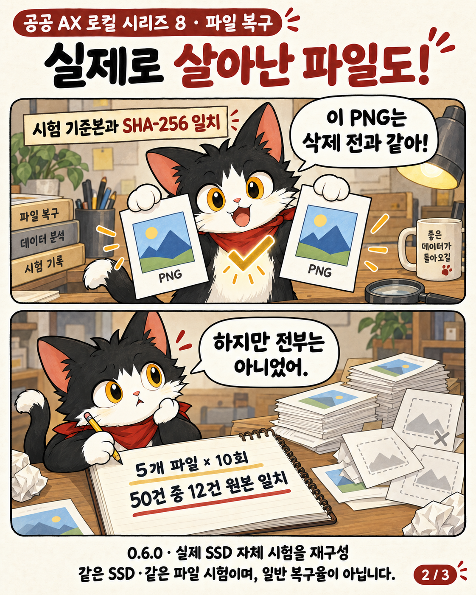
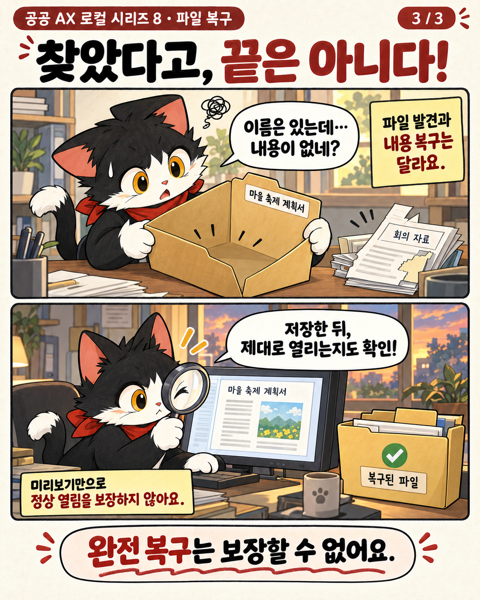

# 공공 AX 로컬 시리즈 8 — 파일 복구

Windows에서 삭제된 파일의 남은 기록과 내용을 찾아 별도 위치에 저장하는 **실험적 기술 시제품**입니다. Electron 화면, Node.js 복구 엔진, C# 읽기 도우미로 구성합니다. 생성형 AI가 파일 본문을 만들어 복원하는 프로그램은 아닙니다.

**공개 현황: 2026-10-02 / 엔진 0.6.1.** 10단계를 모두 검토했지만 모든 기능을 완성한 것은 아닙니다. 필수 기준은 **21/54 인수, 33개 보류**, 별도 조건부 연구는 **0/6 인수**입니다. 이 수치는 복구 성공률도, 현대 포렌식 대비 성능 비율도 아닙니다.

| 구분 | 확인한 결과 | 해석의 범위 |
|---|---|---|
| 실제 SSD 삭제 시험 — 0.6.0 | 단서 50/50, 본문 저장 21/50, 원본 크기·SHA-256 일치 12/50 | 같은 파일 5개의 새 복사본을 10회 시험. 일반적인 복구율이 아님 |
| 이미지 검색 재개 — 0.6.1 | 변경되지 않은 합성 이미지에서 중단 후 재개·이전 추출본 검증 | 새 SSD 삭제 시험과 실제 볼륨 검색 재개는 포함하지 않음 |
| 기존 엔진 인수 — 2026-09-27 | 677 통과 / 실패 0 / 환경 제한 2건 건너뜀 | 코드 회귀 시험이며 실제 파일 복구 677건을 뜻하지 않음 |

**발견 → 저장 → 원본 일치 → 문서 정상 열림은 서로 다른 결과입니다.** 저장 후 SHA-256 재검사는 저장 과정의 무결성을 확인하며, 삭제 전 기준본과의 일치나 외부 문서 앱에서 정상 열리는 것까지 자동으로 증명하지 않습니다.

[현재 진행상황·단계별 보류](docs/STATUS.md) · [기술적으로 시도한 방법과 문제](docs/TECHNICAL_REPORT.md) · [측정 방법·익명화 증거](docs/EVIDENCE.md) · [상세 지원 범위](SUPPORT.md)

## 만화로 보기

실제 시험 기록과 한계를 설명한 AI 생성 만화입니다. 실제 화면 캡처나 개별 파일의 증거 이미지가 아닙니다.





## 현재 할 수 있는 일

- 직접 찾기와 버튼 중심의 질문 안내, 위치·기간·이름 조건, 후보 정렬과 미리보기.
- Windows NTFS의 남은 USN 변경 기록을 이용한 삭제·이름 변경 추적, 비어 있는 MFT 기록 추가 탐색.
- 확인된 본문 구간 읽기, 근거가 연결될 때 원래 이름으로 저장, 파일별 상태와 출처 표시.
- 지원 이미지·파일 형식의 제한적 카빙, 문서 텍스트 미리보기와 일부 손상 내용의 별도 추출.
- 기존 Office 임시 사본·Recent 바로가기 단서 탐색. 단서만 있는 항목은 복구 성공으로 세지 않음.
- **변경되지 않은 디스크 이미지**의 정밀 검색 재개와 이전 추출 파일 재검증.

각 기능의 존재가 모든 매체·모든 파일에서의 성공을 뜻하지 않습니다. 구체적인 지원 조건과 미검증 항목은 기술 보고서와 체크리스트를 따릅니다.

## 아직 해결하지 못한 일

실제 SSD 시험 50건 중 **29건은 저장하지 못했고, 9건은 저장했지만 기준본과 달랐습니다.** 해당 증거만으로 각 실패를 TRIM, 덮어쓰기 또는 파서 문제 중 하나로 확정할 수 없습니다. 일반적인 조각 재조합, 모든 실제 매체 범위·슬랙의 완주, 다양한 문서의 외부 앱 정상 열림, 8GB 사무용 PC의 전체 자원 인수는 남아 있습니다. 전문 포렌식 도구와 동등하다는 검증이나 포렌식 인증도 없습니다.

## 실행과 개발

Windows x64 실험용 배포본은 [GitHub Releases](https://github.com/obundh/gonggong-ax-local-8/releases)에서 ZIP 전체를 내려받아 압축을 풀고 EXE를 실행합니다. EXE 하나만 복사하면 실행되지 않습니다. 코드 서명·모든 장치 호환성을 보장하는 정식 제품이 아닙니다.

원본 장치를 읽거나 복구본을 저장할 때 **앱 작업 공간과 출력 위치를 원본과 다른 물리 디스크에 둡니다.** 같은 디스크의 C:와 D:는 별도 물리 디스크가 아닙니다. 작업 공간은 기본 EXE 옆 `recovery-workspace`이며 `RECOVERY_WORKSPACE` 환경변수로 지정할 수 있습니다. 관리자 읽기 도우미를 사용할 때 Windows 승인이 필요합니다.

개발 환경은 Windows x64와 Node.js 22.23.1에서 확인했습니다. 원시 읽기 도우미 빌드는 Windows의 .NET Framework C# 컴파일러를 사용합니다.

```powershell
npm ci
npm run build:native
npm start
# Windows ZIP 생성
npm run build:win
```

`npm run test:engine`은 개발 중 축적한 회귀 시험입니다. 일부는 E:의 과거 비교 엔진·자료와 Windows 권한에 의존합니다. `npm run test:desktop`도 별도 Playwright 설치와 경로·출력 위치 설정이 필요합니다. **임의 PC의 새 clone에서 모든 시험이 그대로 통과한다고 주장하지 않습니다.** 재현 가능한 고정 입력 시험과 과거 측정을 [증거 문서](docs/EVIDENCE.md)에서 구분했습니다. 실제 삭제 실험 스크립트는 일반 실행 경로가 아니며 이번 공개에서 실행하지 않았습니다.

파일명 임베딩은 별도 선택형 팩입니다. 기본 ZIP에 대형 모델이나 AI 팩을 포함하지 않으며 생성형 대화를 사용하지 않습니다. [모델 범위](models/README.md)와 [제3자 고지](THIRD_PARTY_NOTICES.md)를 참고하세요.

## 공개 범위와 권리

이 저장소에는 앱 소스, 기술 기록, 시험 코드, 익명화 집계, 만화만 포함합니다. 개인 문서·원본/복구본·원시 디스크 이미지·전체 후보 목록·인증 정보·개발 캐시는 포함하지 않습니다. 과거 문서의 E: 경로는 개발 당시 증거 위치이며 외부 공개 자료가 아닙니다.

프로젝트 자체 코드는 기존 `UNLICENSED` 상태를 유지합니다. **공개 열람과 오픈소스 재사용 허락은 다릅니다.** 임의로 MIT 등의 라이선스를 부여하지 않았습니다. 포함된 제3자 구성 요소의 라이선스와 고지는 별도로 유지합니다.

GitHub: https://github.com/obundh/gonggong-ax-local-8  
GitLab: https://gitlab.aigov.go.kr/tyui22/gonggong-ax-local-8
