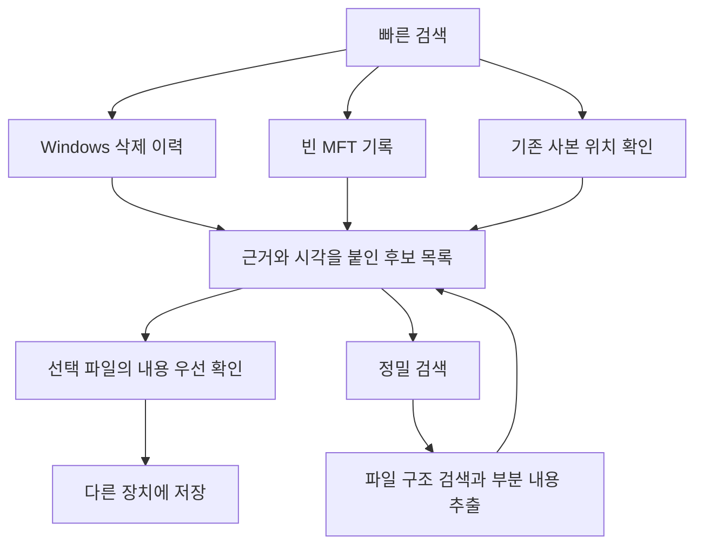

> **개발 이력 문서입니다.** 아래 수치·미지원 상태·실행 경로는 작성 당시 기록이며 최신 상태가 아닐 수 있습니다. 현재 상태는 [공개 현황](docs/STATUS.md)을 따릅니다. 기존 구현표 103/103과 현재 필수 인수 21/54는 서로 다른 기준입니다. 로컬 원자료 전체는 공개하지 않습니다.

# 파일 복구 경로 재설계안

작성일: 2026-09-13. 상태: 설계 후보. 현재 소스·기존 시험 기록과 공식 자료를 대조했다. 아래 제안의 속도·복구율은 새 실험으로 입증하지 않았다. 이번 작업은 설계 문서 작성이며 앱 수정이나 사용자 파일 삭제 시험을 수행하지 않았다.

## 판단

우선순위는 **Windows의 삭제 이력 읽기 + 빈 MFT 기록 탐색 + 선택 파일 본문 검증**을 연결하는 것이다. 이력·기록·본문·기존 사본은 서로 다른 증거이므로 하나의 실패가 모든 경로를 막지 않게 한다. 이후 문서 구조 검색, 부분 내용 추출, 사전 보호를 더한다.

현재 확인된 기반: 기간 검색은 마지막 이력 검증 실패로 잠정 집계 1,542개에서 최종 후보 0개가 됐다. 전체 검색은 약 310만 MFT 자리를 읽다가 후보 10,000개 제한에 걸렸다. 진단용 빈 기록 탐색은 한 시험에서 96,590개 자리를 확인해 대상 3개 기록을 발견했지만 실제 본문 저장까지 완료하지 못했다. 자세한 근거는 [중간 평가서](<C:/Users/USER/Documents/가자 로컬의 세계로/RecoveryChat.GUI/MIDTERM_EVALUATION.md>)에 있다.

## 방법 비교

| 방법 | 풀려는 문제 | 예상 부담 | 주요 한계 | 권고 |
| --- | --- | --- | --- | --- |
| 1. Windows API로 삭제 이력 읽기 | 운영 중인 볼륨의 저널 직접 해석·전체 지문 검증 의존 | 이력량에 비례, 결과 필터링 가능 | 저널 보존 범위·누락, 최초 날짜 탐색 비용 | 최우선 실험 |
| 2. 빈 MFT 자리 먼저 읽기 | 사용 중인 수백만 기록까지 읽는 비용 | 비트맵 + 빈 기록 수·배치 읽기에 비례 | 빈자리 자체에는 삭제 날짜가 없음 | 기본 탐색에 통합 |
| 3. 휴지통 이름 변경 흔적 연결 | $R 이름으로 바뀌어 원래 문서를 못 알아봄 | 수집한 기록·이력의 결합 비용 | 이름·세대·부모 연결이 끊길 수 있음 | 1·2 다음 |
| 4. 선택 파일의 저장 구간 우선 확인 | 목록 완성까지 기다려야 본문 상태를 알 수 있음 | 선택한 파일 크기·조각 수에 비례 | 일부 읽기 성공은 전체 원본 일치 증거가 아님 | 1·2와 함께 |
| 5. 기존 사본·이전 버전 탐색 | 원래 삭제 영역에서 본문을 읽을 수 없음 | 존재하는 백업 위치부터 한정 탐색 | 사본이 미리 존재해야 하고 버전이 다를 수 있음 | 빠른 검색의 별도 경로 |
| 6. 파일 구조 검색과 부분 내용 추출 | MFT 연결을 잃었거나 파일 일부가 손상됨 | 읽는 영역 크기·형식 검증에 비례, 큼 | 조각화·덮어쓰기·읽히지 않는 데이터 | 정밀 검색 |
| 7. 외부 환경·고정 이미지 분석 | 사용 중인 C:의 지속적인 변화 | 준비와 이미지 저장 공간 필요 | 이미 소실된 바이트는 돌아오지 않음 | 고급 경로·시험 기반 |
| 8. 이후 변경만 추적하고 선택 폴더 보호 | 반복 전체 검색, 미래의 삭제 사고 | 기록 추적은 작게 설계 가능, 백업은 내용량에 비례 | 설치 전 사고에 소급 적용 불가 | 후순위 선택 기능 |

부담은 설계상 비교다. 사무용 PC에서의 실제 메모리와 시간은 측정 전이다. 1·2·5는 서로 다른 발견 경로이며, 3·4는 그 결과의 활용·검증 단계다. 여덟 개 모두를 독립적인 복구 엔진으로 세지 않는다.

## 1. Windows가 제공하는 삭제 이력 인터페이스

현재 도우미는 `hello/open/read/assert/close`만 제공하고, 기간 검색은 원시 `$UsnJrnl`을 직접 해석한다. 사용 중인 Windows 볼륨에는 `FSCTL_QUERY_USN_JOURNAL`과 `FSCTL_READ_USN_JOURNAL`을 사용하는 별도 공급자를 제안한다. 이미지 파일에는 기존 원시 파서를 유지할 수 있다.

- 시작 시 저널 ID·읽을 수 있는 시작 위치·현재 끝 위치를 기록하고, 그 범위의 삭제·이름 변경 사건을 배치로 읽는다. 뒤에 새 이력이 추가되는 정상 동작 때문에 이미 읽은 모든 사건을 폐기하지 않는다.
- 중간 잘림·저널 ID 변경은 누락 범위와 원인을 기록한다. 해당 이력에 의존한 연결의 신뢰성을 낮추고 독립 MFT 탐색은 계속한다.
- 끝 위치까지 이어 읽었는지와 읽는 중 누락 오류가 있었는지로 범위 완전성을 평가한다. 다 읽은 뒤 보존 시작 위치가 앞으로 이동했다는 이유만으로 이미 성공적으로 반환된 사건을 전부 버리지 않는다. 저널 ID가 바뀌면 서로 다른 저널의 사건을 한 연속 이력으로 섞지 않는다.
- API의 이유 필터는 반환 자료·해석 부담을 줄일 수 있지만 실제 저장장치 읽기 비용 감소를 보장하지 않는다. 날짜를 주면 바로 찾아가는 API도 아니다. 첫 검색은 보존 이력을 읽을 비용이 남고, 다음 검색부터 저장한 USN 위치·시간 색인을 활용한다.
- 이력 사건은 본문 복구의 증거가 아니다. 과거 파일 ID와 현재 MFT 기록을 연결할 때 재사용·세대·이름을 검증한다.

공식 근거: [읽기 입력과 이유 필터](https://learn.microsoft.com/en-us/windows/win32/api/winioctl/ns-winioctl-read_usn_journal_data_v0), [저널 ID·시작·끝 정보](https://learn.microsoft.com/en-us/windows/win32/api/winioctl/ns-winioctl-usn_journal_data_v0). 고정 종료 위치와 증거별 실패 처리는 이 인터페이스를 이용하는 설계 제안이다.

주의할 함정: `FSCTL_GET_NTFS_FILE_RECORD`는 사용 중인 기록을 반환하며 요청한 번호와 다른 기록을 반환할 수 있다. 삭제된 빈 기록의 원시 읽기를 이 API로 대체하면 안 된다. [Microsoft 문서](https://learn.microsoft.com/en-us/windows/win32/api/winioctl/ni-winioctl-fsctl_get_ntfs_file_record)

작은 실험: 같은 통제된 삭제 사건에서 원시 저널 파서와 네이티브 API의 사건 집합·소요 시간·오류를 비교한다. 저널에 새 사건을 추가하는 조건과 저널이 실제로 잘리는 조건을 분리한다. 운영 C:의 저널을 삭제·재생성해 시험하지 않는다.

## 2. 빈 파일 기록 자리부터 탐색

MFT의 `$BITMAP`은 파일 기록 자리의 사용 여부, 볼륨의 `$Bitmap`은 본문 클러스터의 사용 여부다. 두 지도를 혼동하지 않는다. 3,107,584개 MFT 자리의 비트는 388,448바이트, 약 0.37MiB다. 이 크기는 자리 사용 여부만 나타내며 전체 검색량이나 실행 시간을 의미하지 않는다. [Microsoft MFT 설명](https://learn.microsoft.com/en-us/windows/win32/devnotes/master-file-table)

먼저 빈 비트를 확인하고 해당 MFT 기록을 가까운 구간끼리 묶어 읽는다. 이름·크기·기록 식별자부터 수집하고 무거운 본문 검사는 선택 시 수행한다. 진단 스캐너의 1MiB 비트맵 상한은 페이지 읽기로 바꾸며, 특정 기록의 파싱 오류와 전체 장치 오류를 구분한다.

빈자리에는 오래전에 지운 파일·처음부터 안 쓴 자리도 섞인다. 이 방법만으로 최근 삭제 목록을 만들 수 없다. 삭제 일자를 아는 결과와 시각 미확인 결과를 구분한다. 10,000개 표시·보관 제한 때문에 탐색 끝까지 갔다고 보고하지 않는다.

작은 실험: 고정된 NTFS 이미지에서 전체 기록 탐색과 빈자리 탐색의 후보 집합을 대조하고, 파싱한 기록 수·실제 읽은 바이트·첫 결과까지 시간을 측정한다. 이어 별도 볼륨과 실제 SSD에서 재검증한다.

## 3. 휴지통의 바뀐 이름을 원래 문서와 연결

단순히 `a.pdf` 문자열을 찾는 대신, 삭제 전에 이름이 바뀐 사건과 삭제 사건을 같은 파일의 이력으로 연결한다. 우리 실제 시험에서 `$R...png`로 남은 기록이 발견됐다는 관측을 출발점으로 삼는다.

`원래 이름의 사건 → 휴지통 이름의 사건 → 삭제 사건 → 남은 MFT 기록`을 연결하되, 볼륨 식별자·파일 참조·세대·사건 순서·부모 참조를 함께 확인한다. 이름 변경 전후 정보를 제공하는 USN의 성질을 이용하는 제안이다. [Microsoft 이름 변경 이유 값](https://learn.microsoft.com/en-us/windows/win32/api/winioctl/ns-winioctl-read_usn_journal_data_v0)

삭제된 `$I` 정보 파일이 남아 있으면 형식을 검증해 원래 경로·휴지통 이동 시각·크기를 보조 단서로 쓴다. 휴지통 이동 시각과 휴지통에서 최종 삭제한 시각은 다르다. 같은 접미사나 비슷한 시간만으로 확정 연결하지 않는다. 큰 폴더를 통째로 지운 사건에서는 하위 파일마다 개별 이름 변경 사건이 있다고 가정하지 않는다. 구현·표본 비교 자료로 [RBCmd 휴지통 기록 파서](https://github.com/EricZimmerman/RBCmd)를 참고할 수 있다. 현재 휴지통에 남은 파일을 다시 열거하는 기능 확대보다 비운 뒤 남은 흔적을 대상으로 한다.

상위 폴더도 이동·삭제·재사용됐을 수 있으므로 현재 부모 경로를 과거 경로로 단정하지 않는다. 연결이 부족하면 원래 이름은 미확인으로 남긴다. `$I` 파서와 이력 결합은 실제 Windows 표본으로 검증해야 한다.

작은 실험: 같은 이름의 두 파일, 여러 번 이름을 바꾼 파일, 폴더째 삭제한 파일, 서로 다른 날 휴지통 이동·최종 삭제한 파일로 잘못 연결되는지 확인한다.

## 4. 선택한 파일의 본문 구간을 먼저 확인

수만 후보의 본문을 모두 확인한 뒤 목록을 띄우지 않는다. 기록이 유효한 후보를 선택하면 그 기록의 데이터 구간만 우선 확인한다. 본문이 MFT 안에 있는 resident 파일과 별도 클러스터에 있는 nonresident 파일을 나눈다.

기록·구간 할당 상태 재검증 → 제한된 형식별 일부 읽기 → 전체 읽기·형식 검사 → 다른 물리 디스크에 저장 순서다. 일부 읽기는 정밀 검사의 순서를 정하는 도구다. 앞·중간·끝이 읽히더라도 모든 중간 내용이 온전하다는 뜻은 아니며, 0으로 읽히는 일부 구간만으로 전체 파일을 복구 불가로 확정하지 않는다. 읽기 전후 상태 확인도 운영 중인 볼륨 전체를 원자적으로 고정하는 보장은 아니다.

UI 상태는 `기록만 발견 / 일부 내용 확인 / 전체 읽기·형식 확인 / 저장됨`처럼 관측 사실로 표현한다. 실제 파일은 삭제 전 기준 해시가 보통 없으므로 정상적으로 열리거나 저장본의 해시를 계산했다는 이유로 원본 일치를 주장하지 않는다.

작은 실험: resident 본문, 연속·분할 nonresident 본문, ADS가 붙은 파일, 가운데 구간만 손상된 파일을 사용한다. 전체 복구 SHA-256과 빠른 판정의 오탐을 각각 측정한다.

## 5. 이미 남아 있는 사본으로 내용 확보

기존 File History, 사고 전 시점의 VSS 사본, Office 자동 복구본, 사용자가 지정한 폴더의 중복 문서를 별도 경로로 조사한다. 백업의 존재와 범위를 먼저 확인해 없는 위치를 반복 검색하지 않는다. 이름·크기·버전 시각으로 좁힌 뒤 실제 내용을 비교한다. [File History](https://support.microsoft.com/en-au/windows/backup-and-restore-with-file-history-7bf065bf-f1ea-0a78-c1cf-7dcf51cc8bfc), [Word 자동 복구본](https://support.microsoft.com/en-us/office/recover-an-earlier-version-of-a-word-file-439d91d7-fe33-4edf-aa94-4b631c7ac380)

이 결과에는 `기존 사본`과 출처·저장 시점을 표시한다. 삭제된 원본을 직접 되살린 결과로 세지 않는다. 두 사본의 해시가 같아도 기준 원본이 없으면 삭제 원본과 동일하다는 증명은 아니다.

사고 뒤 새 VSS를 만든다고 과거 파일이 생기지 않는다. 기존 사본에서도 보존된 파일·버전인지 확인해야 하며, VSS가 모든 미할당 공간의 과거 바이트를 보존한다고 가정하지 않는다. [VSS의 시점별 사본 구조](https://learn.microsoft.com/en-us/windows-server/storage/file-server/volume-shadow-copy-service)

작은 실험: 고정된 이전 버전·자동 저장본·동명이인 문서를 만들어 올바른 출처와 버전을 제시하는지 평가한다. 사본 없는 경우를 원본 복구 성공으로 채우지 않는다.

## 6. 이름 대신 파일 구조를 찾고 남은 내용 추출

정밀 검색은 볼륨의 미할당 클러스터를 순차 읽으며 파일 구조를 찾는다. 파일시스템 정보가 손상돼 미할당 지도를 신뢰하지 못하면 별도의 전체 영역 검색이 필요하다. 이름·삭제 시각·파일 위치가 없는 상황에서 검색 시간을 근본적으로 줄일 단서는 적다. PhotoRec도 파일시스템 정보 없이 내용의 구조를 찾으며, 조각화가 복구를 어렵게 한다. [PhotoRec 원리](https://www.cgsecurity.org/wiki/PhotoRec), [미할당 영역 검색](https://www.cgsecurity.org/testdisk_doc/photorec.html)

제안하는 형식별 검증:

- PNG/JPEG: 머리표식뿐 아니라 파일 구조와 디코딩 가능 범위를 검사한다.
- PDF: 내부 객체·참조 구조를 확인한다. `%PDF`와 끝 표식만으로 정상 문서라고 판정하지 않는다.
- HWP: 공통 CFB 머리표식에서 끝내지 않고 HWP의 내부 스트림·압축 구조를 확인한다. [한컴 HWP 파싱 설명](https://tech.hancom.com/python-hwp-parsing-1/)
- HWPX: ZIP 구조와 내부 형식·XML 구성원을 확인한다. [한컴 HWPX 구조](https://tech.hancom.com/hwpxformat/)

완전 복구와 별도로, 검증된 구성원에서 텍스트·그림을 추출하는 `남은 내용 구하기` 경로를 연구한다. 압축된 구성원 자체가 끊기거나 암호화돼 있으면 추출이 실패할 수 있다. 다른 문서의 조각을 추정으로 이어 붙이지 않고, 추출 범위·출처·손상 정보를 함께 저장한다. 생성형 AI로 빠진 문장을 채운 결과는 복구본으로 취급하지 않는다.

작은 실험: 정상 문서, 일부 구성원만 남은 문서, 조각화 문서, 우연히 머리표식만 같은 데이터를 고정 이미지에 넣고 전체 복구·부분 추출·오탐을 따로 평가한다.

## 7. 변화가 적은 환경에서 읽기

고급 경로로 외부 환경에서 원본을 읽거나, 확보한 디스크 이미지를 반복 분석할 수 있다. 장점은 같은 입력을 여러 파서와 실험에 제공하고 운영체제의 추가 쓰기와 경쟁을 줄이는 것이다. 살아 있는 원본에서 이미지를 만드는 과정 자체는 원자적이지 않으므로 그 이미지도 획득 시점·방법·읽기 오류를 기록한다.

전체 이미지는 공간과 시간이 많이 든다. 우선 메타데이터 캡처는 파서 진단에 쓸 수 있지만 본문을 보존한 이미지와 다르다. SSD가 논리 주소로 원래 데이터를 내주지 않게 된 상태는 이 방법으로 되돌릴 수 없다. SSD의 삭제 통보와 가비지 컬렉션도 파일 검색 알고리즘과 별개다. [Kingston SSD 설명](https://www.kingston.com/en/blog/servers-and-data-centers/garbage-collection)

작은 실험: 동일한 고정 이미지에 우리 파서와 독립된 도구를 적용한다. 다른 도구만 실제 원본 바이트를 복원하면 우리 구현의 누락을 조사한다. 양쪽 모두 실패했다는 사실만으로 물리적 복구 불가능을 증명하지 않는다.

## 8. 이후 사고에 대비하는 변화 추적과 내용 보호

두 기능을 구별한다.

- 기록 추적: 마지막 USN 위치·저널 ID와 제한된 파일 식별 정보를 보관하고 다음 실행에서 변경분을 읽는다. 비트맵 전후 차이는 새로 빈 자리를 찾는 보조 수단이며, 두 관측 사이의 생성·삭제·재사용을 모두 포착하지 못한다. 이력 누락이나 볼륨 교체 시 범위를 다시 확인한다.
- 내용 보호: 사용자가 선택한 문서 폴더의 버전을 다른 저장장치에 제한된 용량으로 보관한다. 기록 추적만으로는 소실된 본문이 보존되지 않는다. 삭제 알림을 받은 뒤 복사하는 방식도 이미 늦을 수 있으므로 저장·변경 시점의 버전 보관이 필요하다.

USN은 파일 변화를 다시 찾는 데 사용되지만 변경을 되돌릴 충분한 데이터를 저장하지 않는다. [Microsoft 변경 이력의 한계](https://learn.microsoft.com/en-us/windows/win32/fileio/change-journal-records)

기본 앱에 상시 전체 파일 감시나 AI 모델을 강제하지 않는다. 원하면 켜는 기능으로 두고, 저장 공간·버전 보존 기간·마지막 성공 시점을 보여준다. 이미 삭제된 파일을 사후에 보호할 수 있다고 안내하지 않는다.

## 추가 연구 후보: 폴더 인덱스와 트랜잭션 로그

원래 폴더를 아는 경우 그 폴더의 `$I30` 인덱스와 남은 인덱스 공간에서 이름·파일 참조 단서를 찾는 경로를 연구할 수 있다. 인덱스의 오래된 항목만으로 파일이 삭제됐다고 판정하지 않는다. 현재 MFT 상태와 세대를 대조하고, 모르는 폴더까지 모두 찾는 비용과 구분한다. [Sleuth Kit의 NTFS 복구 설명](https://github.com/sleuthkit/sleuthkit/wiki/NTFS_File_Recovery)

`$LogFile`은 후보가 이미 있을 때 파일 기록 해제·인덱스 변경 등의 보조 단서를 얻는 후순위 연구 대상이다. 전체 문서를 담은 백업이나 완전한 삭제 일시 목록으로 취급하지 않는다. 순환·형식 복잡성 때문에 현재 기본 경로를 여기에 의존시키지 않는다. 실제 파서의 범위를 비교할 자료로 [dfir_ntfs LogFile 구현](https://github.com/msuhanov/dfir_ntfs/blob/master/dfir_ntfs/LogFile.py)이 있다.

## 조합과 사용자 화면

이 도식은 논리적으로 독립된 경로다. 같은 물리 디스크에 많은 읽기를 동시에 보내라는 뜻은 아니다. 물리 디스크별 읽기 큐를 공유하고 선택 파일의 미리보기·복구가 배경 탐색보다 우선하도록 한다. 첫 결과를 보내고 이후 배치로 갱신하며, 전체 크기를 모르는 작업에는 근거 없는 완료율·예상 시간을 표시하지 않는다.

상단 조작은 `빠른 검색`, `정밀 검색`, `저장` 정도로 유지할 수 있다. 기간·이름은 선택 조건이며 날짜 미확인 결과는 별도 보기로 둔다. 채팅은 추가 단서가 필요할 때만 묻는다. 파일명이 없더라도 기간·유형으로 시작할 수 있다. 내부 방법을 사용자가 하나씩 고를 필요는 없다.

핵심 자료 모델은 단일 `복구 가능` 플래그 대신 발견 출처, 과거 사건 시각과 의미, 현재 기록의 신뢰성, 본문 읽기 상태, 지원 범위, 검색 누락 범위를 각각 보관한다. 신뢰할 수 없는 원시 파싱 결과를 검증된 삭제 사건으로 승격하지 않는다.

## 먼저 판별할 세 가지 가설

1. 네이티브 USN 경로가 운영 C:에서 정상적인 저널 추가 때문에 전체 결과가 사라지는 문제를 줄이는가?
2. 빈자리 탐색이 고정 입력에서 후보를 누락하지 않으면서 실제 읽기량·첫 결과 시간을 줄이는가?
3. 그 결과 중 실제 삭제 파일을 하나 이상 선택하여 다른 물리 디스크에 저장하고 삭제 전 SHA-256과 일치시키는가?

이 세 가지를 먼저 확인한다. 시험용 작은 볼륨에서 입력을 통제하고, resident/nonresident·ADS·조각화·삭제 후 지연을 한 조건씩 바꾼다. 그 다음 사용 중인 C:에서 같은 항목을 측정한다. 기준 사본과 정답 이름·기록 번호는 검색기에 넣지 않고 사후 채점에만 사용한다. 사용자 원본을 다시 삭제하는 실험은 이 설계 검토에 포함하지 않는다.

판정은 `이력 사건 / 기록 흔적 / 본문 읽기 / 저장 / 원본 해시 일치 / 기존 사본 / 부분 추출`로 나눠 보고한다. 방법을 추가했다는 이유로 제품 완성률을 올리지 않는다.

독립 검토: `/root/recovery_fast_paths` 완료. 요청 설정 `gpt-5.6-sol/high`, 실제 런타임 모델·추론 설정은 도구에서 확인되지 않았다. 제안 중 현재 휴지통의 재열거는 기존 사용자 방향에 맞춰 우선순위에서 제외했다. 추가 본문 경로 검토 에이전트는 세션 제한으로 시작되지 않아 주 세션에서 조사했다.
