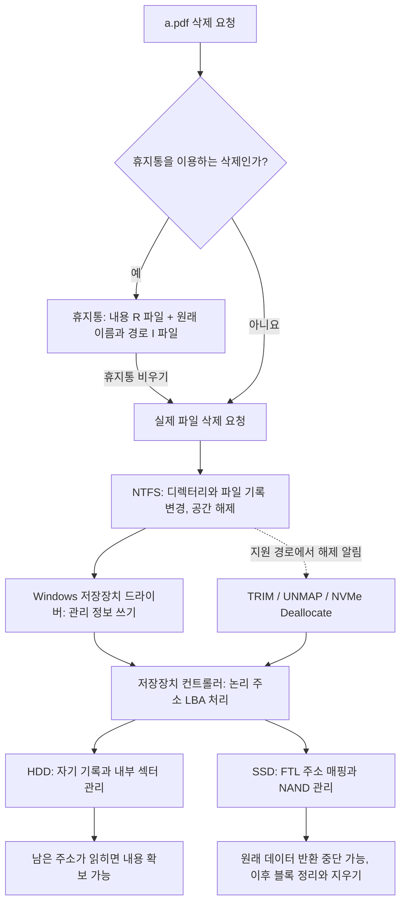
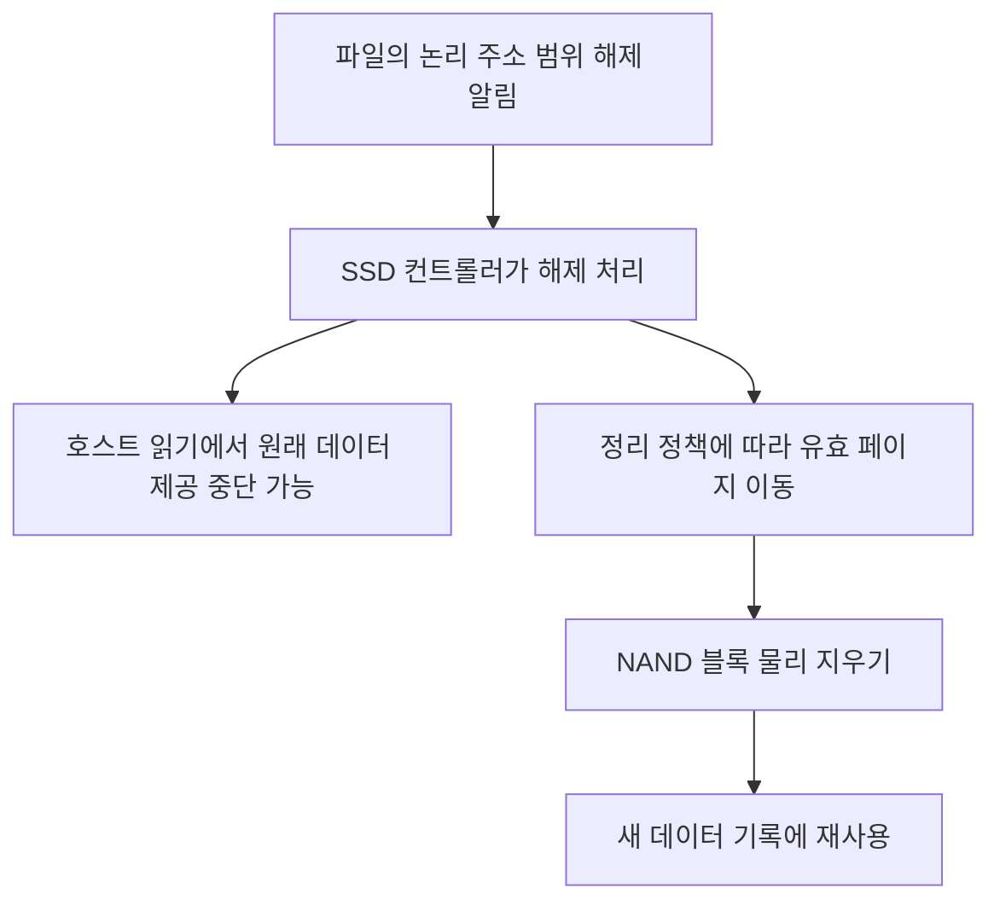

# Windows 파일 삭제에서 하드웨어와 복구까지

조사일: 2026-09-13. 공공 AX 로컬 시리즈 8 - 파일 복구의 설계를 재검토하기 위한 이론 문서다. 일반적인 Windows 로컬 NTFS 파일을 기준으로 설명한다. 아래 설계안과 실험 계획은 구현 완료나 실제 장치 실증을 뜻하지 않는다. 이번 조사에서는 프로그램 수정, 사용자 파일 삭제, 실제 디스크 원시 검색을 수행하지 않았다.

파일이 목록에서 사라진 것, 이름 기록이 없어지는 것, 내용의 논리 주소를 읽을 수 없는 것, 물리 매체의 정보가 사라지는 것은 서로 다른 사건이다. 복구 소프트웨어는 남은 증거를 연결하고 현재 읽히는 내용을 재구성한다. 삭제 동작 전체를 거꾸로 실행하는 기능은 아니다.



이 그림은 계층과 인과관계다. 모든 디스크 쓰기가 이 순서로 즉시 완료된다는 뜻은 아니다. 캐시, 열린 파일, 로그 처리, 드라이버, 장치 펌웨어에 따라 실제 완료 시점이 달라진다.

**파일이 존재할 때의 구조부터 출발한다.** 사용자가 보는 `C:\문서\a.pdf`는 디렉터리 이름, NTFS 파일 기록, 본문 데이터가 연결된 결과다. MFT는 파일의 속성과 본문 또는 본문의 위치 정보를 담는다. 작은 데이터는 MFT 기록 안에 들어갈 수도 있다. 큰 파일의 본문은 여러 구간으로 흩어질 수 있으므로 이름을 찾는 일과 모든 구간을 올바른 순서로 읽는 일은 다르다. [Microsoft MFT 설명](https://learn.microsoft.com/en-us/windows/win32/fileio/master-file-table)

| 용어 | 뜻 | 복구에서의 역할 |
|---|---|---|
| MFT | NTFS의 파일 관리 기록 | 이름, 크기, 속성, 내용 위치의 단서 |
| 파일시스템 클러스터 | NTFS 등이 공간을 배정하는 단위 | 파일 본문 구간을 연결하는 기준 |
| 볼륨 `$Bitmap` | 사용 중인 클러스터 표시 | 해당 영역이 다른 파일에 재사용됐는지 판단 |
| LBA | 장치가 호스트에 제공하는 논리 블록 주소 | 일반 복구 프로그램이 실제로 읽는 주소 |
| FTL | SSD의 논리 주소와 NAND 위치 연결 기능 | 앱이 보는 주소와 실제 칩 위치 사이의 변환 |
| NAND 페이지 / 블록 | 플래시의 기록 단위 / 지우기 단위 | SSD가 내용을 이동하고 지우는 물리 단위 |

클러스터, LBA 블록, NAND 페이지는 같은 단위가 아니다. 크기나 위치 관계를 고정값으로 가정해서는 안 된다. [NTFS 예약 파일 정의](https://learn.microsoft.com/en-us/openspecs/windows_protocols/ms-fscc/b04c3bd0-79dc-4e58-b8ed-74f19fc2ea0a), [Micron NAND 관리 설명](https://www.micron.com/products/storage/nand-flash/choosing-the-right-nand), [NVMe namespace와 LBA](https://nvmexpress.org/resource/nvme-namespaces/)

**일반 삭제로 휴지통에 들어가는 단계에서는 원래 이름과 내용의 이름이 갈라진다.** Vista 이후 조사된 휴지통 형식은 해당 볼륨의 `$Recycle.Bin\<사용자 SID>`에 다음 쌍을 둔다.

```text
원래 파일: C:\문서\a.pdf

$RABC123.pdf : 파일 내용
$IABC123.pdf : 원래 경로 C:\문서\a.pdf, 크기, 휴지통 이동 시각
```

같은 볼륨의 이동은 일반적으로 본문 전체를 새로 복사할 필요 없이 이름과 디렉터리 연결을 변경할 수 있다. 이때 `$I`의 시각은 휴지통으로 보낸 시각이며 나중에 휴지통을 비운 시각과 구별해야 한다. 이 형식은 Microsoft가 보장하는 공개 API 규격이 아니라 포맷 유지보수자의 실측 자료이므로 버전과 길이·쌍의 관계를 검증해야 한다. [recyclebinunit 형식 조사](https://github.com/danielmarschall/recyclebinunit/blob/master/FORMAT.md)

**휴지통을 비우면 그 안의 파일에도 논리 삭제가 일어난다.** Shift+Delete나 휴지통을 사용하지 않는 앱의 삭제는 휴지통 단계를 거치지 않을 수 있다. 일반적인 파일 삭제에서는 디렉터리 연결이 제거되고 파일 기록과 데이터 공간이 재사용 가능해진다. 이것은 내용 전체를 즉시 0으로 덮어쓰는 동작과 다르다. 삭제된 MFT 기록은 재사용될 수 있고, 그 전까지 일부 정보가 남을 수 있다. [Microsoft MFT 삭제 설명](https://learn.microsoft.com/en-us/windows/win32/fileio/master-file-table), [Windows File Recovery 설명](https://support.microsoft.com/en-US/Windows/Experience/Backup-Recovery/windows-file-recovery)

열린 파일의 마지막 핸들, 삭제 방식, 하드 링크 때문에 시점과 결과에는 예외가 있다. 기본 DeleteFile의 삭제 완료는 마지막 핸들 닫힘과 연관되며, POSIX 삭제 방식은 동작이 다르다. 하드 링크가 있으면 이름 하나를 지워도 같은 본문을 가리키는 다른 이름이 남을 수 있다. [DeleteFile](https://learn.microsoft.com/en-us/windows/win32/api/fileapi/nf-fileapi-deletefilew), [하드 링크](https://learn.microsoft.com/en-us/windows/win32/fileio/hard-links-and-junctions)

**남는 기록은 역할이 다르다.**

| 흔적 | 얻을 수 있는 단서 | 얻었다고 보장할 수 없는 것 |
|---|---|---|
| 삭제된 MFT 기록 | 당시 이름, 크기, 내용 위치와 일부 데이터 | 해당 내용이 지금도 온전하다는 보장 |
| 살아 있거나 삭제된 `$I` 정보 | 휴지통 이전 이름, 경로, 이동 시각 | 대응하는 `$R`의 본문 생존 |
| USN 변경 기록 | 파일 참조, 이름 변경, 삭제 사건과 시각 | PDF 본문 전체, 모든 과거 사건 |
| NTFS `$LogFile` | 파일시스템 변경의 일부 흔적 | 모든 문서의 과거 버전 |
| 읽히는 본문 영역 | 파일 조각 또는 전체 데이터 | 원래 이름, 경로, 원본과의 동일성 |

USN은 변경을 완전히 되돌릴 만큼의 정보를 저장하지 않고 오래된 기록도 없어질 수 있다. `$LogFile`은 파일시스템 일관성 복구용이며 일반 파일 백업이 아니다. 다만 관리 정보나 작은 데이터 조각의 가능성을 전부 부정해서도 안 된다. 따라서 기록들을 파일 참조·세대·부모 관계로 연결해야 하며, 같은 이름이나 같은 크기만으로 같은 파일이라고 단정할 수 없다. [Change Journal의 한계](https://learn.microsoft.com/en-us/windows/win32/fileio/change-journal-records), [USN V2 구조](https://learn.microsoft.com/en-us/windows/win32/api/winioctl/ns-winioctl-usn_record_v2), [NTFS 일관성 복구](https://learn.microsoft.com/en-us/windows-server/storage/file-server/ntfs-overview)

**Windows 아래에서는 파일 이름 대신 주소를 중심으로 요청을 처리한다.** 개념적인 경로는 앱/탐색기 → Windows I/O와 파일시스템 → 볼륨·파티션 관리 및 필요한 필터 → 디스크 클래스·포트·장치 드라이버 → SATA/NVMe/USB 등의 장치 경로 → 컨트롤러다. 실제 드라이버 구성은 장치와 암호화·가상화 여부에 따라 다르다. [Windows 저장장치 드라이버 구조](https://learn.microsoft.com/en-us/windows-hardware/drivers/storage/storage-driver-architecture)

파일시스템은 삭제에 따른 관리 정보 쓰기와 지원되는 공간 해제 알림을 아래로 전달할 수 있다. 관련 명령은 ATA TRIM, SCSI UNMAP, NVMe Dataset Management의 Deallocate 등이다. USB 변환 장치·RAID·가상 디스크·드라이버를 통과하면서 처리 여부가 달라질 수 있다. 장치가 TRIM을 지원한다는 정보만으로 특정 파일의 TRIM 완료 시점을 증명할 수는 없다. [Windows의 TRIM/UNMAP 전달](https://learn.microsoft.com/en-us/windows-hardware/drivers/storage/thin-provisioning), [Windows NVMe Deallocate 시험 설명](https://learn.microsoft.com/en-us/windows-hardware/test/hlk/testref/b840451f-39f8-4a4a-9aad-a3689e70f5e3)

Windows RAM의 파일 캐시와 저장장치 내부 캐시도 있다. Windows의 캐시 쓰기는 나중에 디스크로 반영될 수 있으므로 버튼을 누른 시각과 매체 변경 완료 시각을 같게 보면 안 된다. RAM에 우연히 문서 조각이 남는 경우와 디스크 복구는 별도 문제이며, 메모리를 더 깊이 읽는다고 삭제된 파일 전체가 반드시 나오는 구조도 아니다. [Microsoft 캐시 설명](https://learn.microsoft.com/en-us/windows-server/administration/performance-tuning/subsystem/cache-memory-management/)

**HDD에서는 논리 삭제 후에도 자기 기록이 남을 수 있다.** 일반적인 경우 파일시스템이 연결만 해제하면 해당 위치의 내용은 새 데이터로 덮이기 전까지 읽힐 가능성이 있다. 메타데이터가 남으면 구간을 따라 읽고, 없으면 본문 구조를 찾는 카빙을 시도한다. 실제 원래 저장 위치의 정보가 새 내용으로 대체됐다면 일반 소프트웨어의 추가 검색으로 이전 내용을 되돌릴 수 없다. [Kingston의 HDD·SSD 삭제 비교](https://www.kingston.com/en/blog/servers-and-data-centers/garbage-collection)

실제 물리 매체에서는 회전하는 원판의 자성 상태에 정보를 기록하고 읽기·쓰기 헤드로 접근한다. 컨트롤러와 읽기 회로가 이 신호를 데이터로 처리한다. 원판에는 `a.pdf`라는 문서 개념이 없으며, 파일 이름과 본문을 연결하는 일은 상위 파일시스템의 역할이다. [Seagate의 HDD 구성 설명](https://www.sec.gov/Archives/edgar/data/1137789/000113778925000211/stx-20250909.htm)

HDD 역시 완전히 단순한 물리 주소 배열은 아니다. 불량 섹터 재할당이 있고, 일부 SMR 드라이브는 내부 주소 변환과 데이터 재배치를 사용한다. 따라서 HDD라는 이유만으로 특정 LBA의 내용 보존을 보장하면 안 된다. [Seagate 배포 SMR 관리 자료](https://www.seagate.com/files/www-content/solutions-content/it-professionals/_shared/docs/smr-requires-new-data-management-usenix-login-feldman-gibson.pdf)

**SSD에서는 논리 주소와 실제 NAND 위치 사이에 FTL이 있다.** 예를 들어 OS가 읽는 LBA 10000이 지금은 NAND의 어떤 페이지에 대응해도 다음 기록에서는 다른 페이지로 연결될 수 있다. 주소 변환, 오류 정정, 불량 블록 관리, 마모 분산 등은 컨트롤러가 맡는 기능이다. [Micron NAND 관리 설명](https://www.micron.com/products/storage/nand-flash/choosing-the-right-nand)

칩의 가장 작은 저장 요소인 NAND 셀은 절연된 저장층의 전하 상태로 정보를 유지한다. 전하에 따라 전류가 흐르기 시작하는 문턱 전압이 달라지고, 읽기 회로는 이 상태를 구분해 비트로 해석한다. 기록과 물리 지우기는 전압을 가해 전하 상태를 바꾸는 과정이다. 따라서 파일 목록에서 이름을 없애는 동작과 셀의 상태를 지우는 동작은 서로 다른 계층에 있다. [KIOXIA의 NAND 셀 구조와 기록·읽기·지우기 원리](https://www.kioxia.com/en-jp/rd/technology/nand-flash.html)

NAND는 일반적으로 페이지에 기록하고 블록 단위로 지운다. 컨트롤러는 유효한 페이지를 다른 곳으로 옮긴 뒤 블록을 지워 재사용할 수 있다. 이를 가비지 컬렉션(GC)이라고 한다. TRIM은 더 이상 필요한 데이터가 아니라는 정보를 알려 이 정리에 활용하게 한다. GC 시점은 기종과 펌웨어·부하 등에 달려 있고 모든 SSD가 동일하게 백그라운드에서 정리하는 것은 아니다. [Kingston GC 설명](https://www.kingston.com/en/blog/servers-and-data-centers/garbage-collection)



여기서 중요한 해석은 다음과 같다. **물리적으로 아직 지우지 않았더라도 일반 읽기에서 원래 데이터가 나오지 않을 수 있다. 반대로 0으로 읽힌다는 사실만으로 NAND 물리 지우기 완료를 증명할 수도 없다.** 이는 논리 읽기 규칙과 GC 구조를 함께 고려한 결론이다.

2026-07-31 NVM Command Set 1.3의 §3.3.3.2.1(인쇄 p.48)은 해제된 블록의 읽기를 DRB에 따른 0/FF 또는 설정된 DULBE 오류로 설명한다. 과거 규격과 실제 설치된 장치의 동작은 다를 수 있으므로 오래된 설명이나 최신 규격 하나를 모든 SSD에 적용해서는 안 된다. TRIM/Deallocate와 Sanitize·Secure Erase도 같은 기능으로 취급하지 않는다. [NVM Express NVM Command Set 1.3](https://nvmexpress.org/wp-content/uploads/NVM-Express-NVM-Command-Set-Specification-Revision-1.3-Ratified-2026.07.31.pdf), [현재 규격 목록](https://nvmexpress.org/specification/nvm-command-set-specification/). 규격 저작권: © 2008 to 2026 NVM Express, Inc. ALL RIGHTS RESERVED.

**관리자 권한으로 읽을 수 있는 범위에는 경계가 있다.**

| 접근 단계 | 얻는 것 | 자동으로 얻지 못하는 것 |
|---|---|---|
| 일반 파일 API | OS에 현재 존재하는 파일과 권한상 허용된 내용 | 삭제된 모든 파일 |
| 원시 볼륨·디스크 읽기 | Windows와 장치가 반환하는 논리 블록 | SSD의 모든 과거 NAND 페이지 |
| 장치별 전문 도구 | 지원 기종의 진단·내부 기능 등 | 모든 기종 공통 우회와 복구 보장 |
| 칩 직접 읽기·물리 수리 | 조건에 따라 물리 조각 또는 장치 접근 회복 | 원래 순서·오류 정정·암호화까지 자동 해결 |

`PhysicalDrive`를 연다는 것은 전체 디스크의 논리 주소 공간에 접근한다는 뜻이지 NAND 셀을 직접 읽는다는 뜻이 아니다. 우리 VolumeReader의 원시 읽기 역시 이 경계를 따른다. 새 커널 드라이버를 만든다는 사실만으로 컨트롤러가 숨긴 이전 페이지가 나타나지는 않는다. 이는 Windows 장치 API와 FTL 구조로부터 도출되는 한계다. [CreateFile의 디스크·볼륨 접근](https://learn.microsoft.com/en-us/windows/win32/api/fileapi/nf-fileapi-createfilea), [NVMe namespace](https://nvmexpress.org/resource/nvme-namespaces/)

칩에서 조각을 읽더라도 주소 매핑·오류 정정·불량 블록 처리 등을 알아야 파일로 조립할 수 있다. 암호화가 적용됐다면 필요한 키도 있어야 한다. BitLocker로 잠긴 볼륨은 적절한 복구 정보가 필요하며, 올바르게 수행된 암호학적 삭제로 필요한 키가 없어졌다면 남은 암호문만으로 원문을 복원할 수 있다고 가정할 수 없다. 일반 휴지통 비우기가 BitLocker 키까지 삭제한다는 뜻은 아니다. [Microsoft BitLocker 복구](https://learn.microsoft.com/en-us/windows/security/information-protection/bitlocker/bitlocker-recovery-guide-plan), [NIST SP 800-88 Rev.2](https://csrc.nist.gov/pubs/sp/800/88/r2/final)

**복구는 남은 증거에서 파일을 다시 구성하는 별도 흐름이어야 한다.** 다음은 위 이론에 따른 프로그램 설계 제안이다.

1. 장치·파일시스템·암호화 상태와 실제 읽을 수 있는 범위를 확인한다. 알 수 없는 상태는 추측하지 않는다.
2. 원본 쓰기를 최소화하고 가능한 경우 별도 장치의 읽기 이미지로 작업한다. 실행 중인 시스템은 다른 프로그램과 Windows가 계속 바꾸므로 읽기 전용 앱만으로 원본 전체가 고정되지는 않는다.
3. 현재 휴지통, 삭제 MFT, 읽히는 삭제 `$I`, 남은 USN 등을 수집한다. 각 단서의 출처·범위·읽기 실패를 남긴다.
4. 같은 볼륨·부모 참조·파일 참조/세대·휴지통 토큰 등을 확인해 원래 이름을 연결한다. 불확실한 연결은 가설로 남긴다.
5. 이름을 확인하지 못한 `$R` 파일과 생성 이름의 카빙 후보도 보존한다. 사용자가 `a.pdf`를 검색했다고 이런 후보를 버리지 않는다.
6. 기록이 가리키는 구간을 읽거나, 읽히는 영역에서 PDF 등의 구조를 찾아 재구성한다. 조각화·재사용·부분 손실·지원하지 않는 압축/암호화는 별도 상태로 둔다.
7. 후보를 고르면 별도 위치에 저장하고 형식 검사를 수행한다. 저장할 바이트를 얻었다는 것과 정상 PDF라는 것을 구분한다. 원본 해시가 있는 시험에서는 전체 바이트 동일성까지 비교한다.

볼륨 잠금은 실행 중인 시스템·페이지 파일 등의 제약을 받는다. 디스크 이미지도 장치가 이미 0이나 오류만 반환하는 내용을 되살려 담아 주지는 않는다. VM 시험의 성공을 실제 SSD의 TRIM/GC 환경 성공으로 확대 해석하면 안 된다. [볼륨 잠금 제약](https://learn.microsoft.com/en-us/windows/win32/api/winioctl/ni-winioctl-fsctl_lock_volume)

`a.pdf`의 결과는 적어도 다음처럼 나눠야 한다.

| 발견 상태 | 올바른 표시 |
|---|---|
| 원래 이름과 온전한 내용 확보 | 이름 확인 + 파일 구조 확인 + 저장 결과 |
| 원래 이름만 확인, 내용은 읽기 불가 | 이름/삭제 기록만 발견 |
| 원래 이름 불명, PDF 내용 확보 | 이름 미확인 PDF 후보 |
| 일부 페이지만 정상적으로 재구성 | 부분 복구와 확인 가능한 범위 |
| 바이트 저장은 됐지만 PDF 검사 실패 | 저장됨, 형식 검사 실패 |
| 시험 원본 해시와 복구본 일치 | 시험 원본과 바이트 동일 |

파일이 열린다는 사실도 모든 페이지·첨부·서명·내용이 원본과 동일하다는 증명은 아니다. 복구본 자체의 SHA-256은 이후 변경 여부를 확인하는 지문이며 비교할 원본 해시가 없으면 원본 동일성을 증명하지 못한다. AI나 임베딩은 남은 이름·내용으로 후보를 정렬할 수 있지만 소실된 원본 바이트를 증거 없이 만들어 복구본이라고 제시해서는 안 된다.

**현재 구현에 대한 판단은 별도로 남긴다.** 2026-09-13 코드에서 현재 휴지통의 `$I/$R` 해석, 삭제 MFT 읽기, 제한적 USN 삭제 시각 연결, PDF 카빙은 확인했다. 그러나 삭제된 `$I`와 `$R`의 원래 이름 연결은 빠져 있다. 이름 필터가 내부 이름의 후보를 제외할 수 있고, PDF 카빙 검사는 헤더·객체·끝 표시 수준이어서 완전한 내용 검증으로 볼 수 없다. 근거 파일은 `engine/recycle-bin.mjs`, `engine/ntfs-image.mjs`, `engine/job-worker.mjs`, `engine/candidate-filter.mjs`, `engine/carving.mjs`다. 이번에는 수정하지 않았다.

다음 실험은 알려진 원본 PDF와 해시를 가진 격리 Windows 환경의 전용 시험 디스크에서 해야 한다. 사용자 자료가 들어 있는 디스크를 대상으로 하지 않는다.

| 실험 | 판정해야 할 사항 |
|---|---|
| 일반 삭제, 휴지통 유지 | 원래 이름·경로와 실제 내용의 정확한 연결 |
| 휴지통 비우기 직후 | 실제 Windows가 만든 삭제 기록에서 이름 연결과 본문 복구 |
| Shift+Delete | 휴지통 정보가 없는 삭제 경로 |
| 이름 정보만 소실 | 이름 미확인 후보를 검색에서 유지 |
| 본문만 소실·재할당 | 이름 발견을 정상 복구로 오인하지 않음 |
| 같은 이름 여러 개·기록 재사용 | 잘못된 파일을 원본으로 연결하지 않음 |
| 분할 PDF·일부 구간 손실 | 전체 복구와 부분 복구를 구별 |
| 실제 시험용 HDD·SSD | 해당 장치의 읽기·해제·변경 조건을 별도 기록 |

가상 디스크가 실제 SSD 위에 저장돼도 게스트와 호스트의 TRIM 전달·할당 방식이 개입한다. 따라서 결정론적 합성 이미지 시험, Windows의 실제 삭제 동작 시험, 실제 매체 시험을 각각 다른 증거로 취급한다. FAT/exFAT는 NTFS와 관리 구조가 다르고, 서버·NAS·클라우드의 온라인 전용 파일은 별도 저장 위치의 문제이므로 로컬 NTFS 원시 복구로 일괄 처리하지 않는다.
